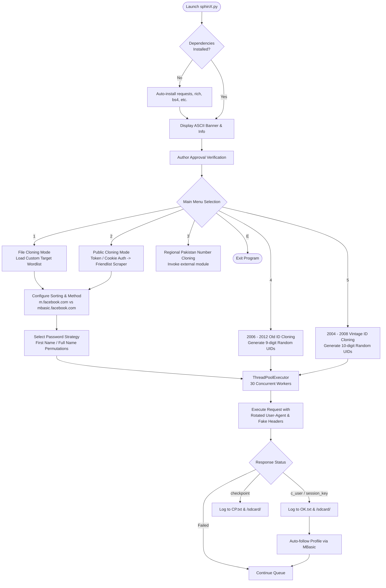

<div align="center">

# ⚡ sphinX — Advanced Facebook Account Auditing & Cloning Framework

<p align="center">
  <strong>A high-concurrency Facebook multi-vector auditing, OSINT reconnaissance, and credential security assessment utility.</strong>
</p>

[](https://www.python.org/)
[](https://github.com/CodeWithTanim/sphinX)
[](https://github.com/CodeWithTanim/sphinX)
[](LICENSE)
[](https://github.com/CodeWithTanim/sphinX/graphs/commit-activity)
[](https://github.com/MSRTanim)

<br/>

```text
▄▄▄█████▓ ▒█████  ▒██   ██▒ ██▓ ▄████▄  
▓  ██▒ ▓▒▒██▒  ██▒▒▒ █ █ ▒░▓██▒▒██▀ ▀█  
▒ ▓██░ ▒░▒██░  ██▒░░  █   ░▒██▒▒▓█    ▄ 
░ ▓██▓ ░ ▒██   ██░ ░ █ █ ▒ ░██░▒▓▓▄ ▄██▒
  ▒██▒ ░ ░ ████▓▒░▒██▒ ▒██▒░██░▒ ▓███▀ ░
  ▒ ░░   ░ ▒░▒░▒░ ▒▒ ░ ░▓ ░░▓  ░ ░▒ ▒  ░
    ░      ░ ▒ ▒░ ░░   ░▒ ░ ▒ ░  ░  ▒   
  ░      ░ ░ ░ ▒   ░    ░   ▒ ░░        
             ░ ░   ░    ░   ░  ░ ░      
                               ░        
===================================================
   [+] AUTHOR   : MD SAMIUR RAHMAN TANIM
   [+] TEAM     : TOXIC CYBER SECURITY
   [+] VERSION  : 1.0.0 (STABLE)
===================================================
```

</div>

---

## 📋 Table of Contents

- [Overview](#-overview)
- [Key Highlights](#-key-highlights)
- [Complete Feature Inventory](#-complete-feature-inventory)
  - [1. Authentication & Session Management](#1-authentication--session-management)
  - [2. Multi-Vector Target Gathering](#2-multi-vector-target-gathering)
  - [3. High-Speed Cracking & Auditing Engines](#3-high-speed-cracking--auditing-engines)
  - [4. Dynamic Password Profiler](#4-dynamic-password-profiler)
  - [5. Evasion & Fingerprint Rotation](#5-evasion--fingerprint-rotation)
  - [6. Real-Time Dashboard & Output Logging](#6-real-time-dashboard--output-logging)
- [Architecture & Execution Workflow](#-architecture--execution-workflow)
- [Menu & Navigation Reference](#-menu--navigation-reference)
- [Installation Guide](#-installation-guide)
  - [Android (Termux)](#android-termux)
  - [Linux (Debian/Ubuntu/Kali)](#linux-debianubuntukali)
  - [Windows](#windows)
- [Usage Walkthrough](#-usage-walkthrough)
- [Output & Artifact Structure](#-output--artifact-structure)
- [Technical Specifications](#-technical-specifications)
- [Disclaimer & Ethical Usage](#-disclaimer--ethical-usage)
- [Author & Credits](#-author--credits)

---

## 📖 Overview

**sphinX** (developed by **TOXIC CYBER SECURITY**) is an all-in-one Facebook penetration testing and account security assessment tool written in Python. Tailored for cybersecurity researchers, penetration testers, and OSINT analysts, the tool evaluates the strength of credentials and account security postures using multi-threaded brute-force verification, Facebook Graph API extraction, and direct mobile authentication protocols.

Whether harvesting targets from public friend lists, auditing custom target wordlists, or enumerating vintage account ranges (from 2004 to 2012), sphinX delivers reliable performance with low memory footprint across Termux, Linux, and Windows environments.

---

## ✨ Key Highlights

- ⚡ **Multi-Threaded Concurrency**: Powered by Python's `concurrent.futures.ThreadPoolExecutor` with up to 30 parallel workers.
- 🎯 **Vintage Account Enumeration**: Dedicated engines to discover and assess legacy Facebook IDs dating back to 2004–2012.
- 🌐 **Dual Mobile Protocol Engines**: Leverages both lightweight mobile web interfaces (`mbasic.facebook.com` / `m.facebook.com`) and direct Android native app endpoints (`b-api.facebook.com`).
- 🔄 **Extensive User-Agent Pool**: Integrates over 100+ real-world mobile browser and Android Dalvik fingerprints to circumvent network heuristics and automated rate-limiting.
- 🍪 **Flexible Authentication**: Supports both access token verification (`EAAG...`) and direct session cookie extraction from Facebook Business Locations.
- 📱 **Termux & Mobile-Ready**: Optimized for Android deployment via Termux with native `/sdcard/` logging support.

---

## 🚀 Complete Feature Inventory

Below is an exhaustive breakdown of every single capability and feature built into the **sphinX** framework:

### 1. Authentication & Session Management

- **Dual Authentication Modes**:
  - **Token-Based Authentication (`01`)**: Authenticate directly with Facebook Graph API access tokens. Validates token status via `https://graph.facebook.com/me` and persists active sessions to `.token.txt`.
  - **Cookie-Based Extraction (`02`)**: Ingests raw Facebook browser cookies, initiates an authenticated request to `business.facebook.com/business_locations`, and automatically extracts elevated business Graph tokens (`EAAG...`) via regular expression matching.
- **Session Caching**: Automatically persists valid authentication tokens to local disk (`.token.txt`) for instant re-authentication across sessions without repetitive logins.
- **Automatic Session Cleanup**: Automatically purges invalid or expired tokens (`rm -f .token.txt`) upon detection of connection timeouts or permission errors.
- **Automated Profile Engagement (`follow()`)**: On generating a valid session, automatically parses profile elements with BeautifulSoup to initiate automated profile following via mobile endpoints.

---

### 2. Multi-Vector Target Gathering

- **File-Based Target Ingestion (`[1] FILE CLONING`)**:
  - Ingests custom text target files (`ID|NAME` or raw UID lists).
  - Validates file paths, handles missing files gracefully, and parses input line-by-line into memory.
- **Public Friend List Scraper (`[2] PUBLIC CLONING`)**:
  - Connects to the Facebook Graph API (`v2.0`).
  - Queries `?fields=friends.limit(5000)` against any public target account.
  - Automatically parses JSON responses to extract target names and unique IDs formatted as `UID|Full Name`.
  - Displays instant target tally (`Total : <count>`).
- **Pakistan / Regional Telecom Random Ingestion (`[3] PAK RANDOM CLONING`)**:
  - Modular integration to invoke external targeted carrier network scripts (`mrd1.py`) for regional mobile number auditing.
- **Vintage 2006–2012 ID Generator (`[4] 2006 TO 2012`)**:
  - Algorithmic random generator yielding 9-digit UIDs (`111111111` to `999999999`).
  - Configurable batch size up to **50,000 IDs** per session.
  - Tailored for legacy password patterns (`123456`, simple numerical sequences).
- **Early 2004–2008 ID Generator (`[5] 2004 TO 2008`)**:
  - Algorithmic generator producing early 10-digit UIDs (`1111111111` to `9999999999`).
  - Configurable batch size up to **50,000 IDs**.
  - Optimized for the earliest Facebook registration blocks.

---

### 3. High-Speed Cracking & Auditing Engines

- **Multi-Threaded Worker Pool**: Employs `ThreadPoolExecutor(max_workers=30)` to test credentials asynchronously with minimal latency.
- **Target Sorting & Randomization (`setting()`)**:
  - `[01] Oldest First`: Tests vintage IDs first.
  - `[02] Newest First`: Tests recently created IDs first.
  - `[03] Randomize / Shuffle`: Shuffles the ID queue randomly using `random.randint` and list insertion to minimize consecutive request patterns.
- **Dual Verification Engines**:
  - **Method 1 (`mobile` — `crack()` engine)**:
    - Hits `https://m.facebook.com/login/device-based/password/?uid=...`.
    - Scrapes real-time CSRF tokens (`lsd`) and security entropy tokens (`jazoest`).
    - Submits credential payload via `/login/device-based/validate-password/`.
    - Identifies successful logons by validating the `c_user` cookie.
  - **Method 2 [BEST] (`free` — `free()` engine)**:
    - Targets ultra-lightweight `https://mbasic.facebook.com/` endpoints.
    - Bypasses rich content assets to maximize request throughput and reduce bandwidth.
    - Dynamically extracts form tokens and verifies responses against checkpoint conditions.
  - **Method 3 (`b-api` Native Android Auth — `api()` engine)**:
    - Directly interfaces with Facebook's native private Android login API:
      `https://b-api.facebook.com/method/auth.login`
    - Emulates native Katana / Messenger app requests using application client ID (`350685531728|62f8ce9f74b12f84c123cc23437a4a32`).
    - Parses JSON response bodies for `session_key`, `EAAA` tokens, and error structures.

---

### 4. Dynamic Password Profiler

sphinX includes an intelligent password generator (`passmenu()`) that derives potential passwords directly from target profile metadata:

| Option | Method Name | Description | Generated Patterns |
| :--- | :--- | :--- | :--- |
| **`[01]`** | **First Name Digit Pass** (`first()`) | Extracts the target's first name and appends frequent numerical sequences. | `<firstname>445566`, `<firstname>123`, `<firstname>12345` |
| **`[02]`** | **All Name Password** (`name()`) | Combines full names, first names, and cultural/regional number combinations. | `<fullname>`, `<firstname>12345`, `<firstname>786`, `<firstname>123`, `<firstname>1234` |
| **`[03]`** | **All Name+ Password** (`name2()`) | Expanded permutations combining lowercase strings with high-probability suffix sets. | `<firstname>445566`, `<firstname>123`, `<firstname>12345`, `<firstname>1234`, `<firstname>786` |
| **Custom** | **Vintage Passwords** (`old()` / `old2()`) | User-supplied custom password string (minimum 6 characters) applied across generated UIDs. | `123456`, custom user wordlist |

---

### 5. Evasion & Fingerprint Rotation

- **Massive User-Agent Rotation (`ugen` & `ugen2`)**:
  - Over **100+ curated User-Agents** spanning Android devices (Samsung Galaxy S-Series, Note, M-Series, A-Series), Dalvik runtimes (1.6.0, 2.1.0), and desktop browsers.
  - Rotates randomly per authentication attempt via `random.choice(ugen)`.
- **Realistic Network Header Emulation**:
  - Injects native Android carrier headers into B-API requests:
    - `x-fb-connection-bandwidth`: `20000000.0` - `30000000.0`
    - `x-fb-connection-quality`: `EXCELLENT`
    - `x-fb-connection-type`: `cell.CTRadioAccessTechnologyHSDPA`
    - `x-fb-http-engine`: `Liger`
- **Airplane Mode Advisory**:
  - Real-time notification prompting users to toggle Airplane Mode every 5 minutes or 10 seconds to refresh dynamic cellular IP allocations and evade rate limiting.
- **Robust Connection Recovery**:
  - Wraps network transactions in `requests.exceptions.ConnectionError` and timeout handlers to prevent execution abortion during packet drops.

---

### 6. Real-Time Dashboard & Output Logging

- **Live In-Flight Dashboard**:
  - Displays real-time progress right inside your shell:
    ```text
    [CRACK] 1540/50000 | [OK] 12 | [CP] 45
    ```
- **Categorized Results Segmentation**:
  - **`[OK]` Successful Hits**: Accounts cracked with full credential and cookie details.
  - **`[CP]` Checkpoint Hits**: Accounts that hit two-factor authentication (2FA) or identity checkpoints.
- **Comprehensive Output Persistence**:
  - Logs results to date-stamped files (`OK-DD-MM-YYYY.txt`, `CP-DD-MM-YYYY.txt`).
  - Automatic backup to Android shared storage (`/sdcard/SUCCESSFULL-TOXIC.txt` and `/sdcard/BRAND-CP.txt`).

---

## 🏗️ Architecture & Execution Workflow

The following diagram illustrates the internal flow of sphinX from initialization to result logging:



---

## 🧭 Menu & Navigation Reference

```text
┌────────────────────────────────────────────────────────┐
│             sphinX CLI NAVIGATION MAP                  │
└────────────────────────────────────────────────────────┘
├── [1] FILE CLONING
│    ├── File Path Prompt (.txt file)
│    ├── ID Ordering:
│    │    ├── [01] Oldest IDs First
│    │    ├── [02] Newest IDs First
│    │    └── [03] Randomize / Shuffle
│    ├── Engine Selection:
│    │    ├── [01] Method 1 (m.facebook.com)
│    │    └── [02] Method 2 [BEST] (mbasic.facebook.com)
│    └── Password Strategy:
│         ├── [01] First Name Digit Pass
│         ├── [02] All Name Password
│         └── [03] All Name+ Password
│
├── [2] PUBLIC CLONING
│    ├── Authentication:
│    │    ├── [01] Login With Token (Manual EAAG Token)
│    │    └── [02] Login With Cookie (Auto EAAG from Business)
│    ├── Target Facebook UID Prompt
│    ├── Graph API Friendlist Dump (up to 5,000 friends)
│    └── Settings & Passwords (Identical to File Cloning)
│
├── [3] PAK RANDOM CLONING
│    └── External Pakistan Carrier Script (mrd1.py)
│
├── [4] 2006 TO 2012 OLD ID CLONING
│    ├── Target Volume (Up to 50,000 IDs)
│    ├── Target Password Input (Min 6 Characters)
│    └── B-API Native Android Multi-Threaded Cracker
│
├── [5] 2004 TO 2008 VINTAGE ID CLONING
│    ├── Target Volume (Up to 50,000 IDs)
│    ├── Target Password Input (Min 6 Characters)
│    └── B-API Native Android Multi-Threaded Cracker
│
└── [E] EXIT
```

---

## 💻 Installation Guide

### Android (Termux)

Termux is the primary recommended environment for sphinX. Run the following commands:

```bash
# Update and upgrade packages
pkg update -y && pkg upgrade -y

# Grant storage access (required for saving results to /sdcard/)
termux-setup-storage

# Install required dependencies
pkg install python git -y

# Clone the repository
git clone https://github.com/CodeWithTanim/sphinX.git

# Navigate into project directory
cd sphinX

# Install Python requirements
pip install requests rich bs4 futures

# Run sphinX
python sphinX.py
```

### Linux (Debian/Ubuntu/Kali)

```bash
# Update system package lists
sudo apt update && sudo apt upgrade -y

# Install Python3, pip, and git
sudo apt install python3 python3-pip git -y

# Clone repository
git clone https://github.com/CodeWithTanim/sphinX.git

# Enter repository directory
cd sphinX

# Install Python dependencies
pip3 install requests rich bs4 concurrent-log-handler

# Run sphinX
python3 sphinX.py
```

### Windows

```powershell
# Clone the repository via Git Bash or Command Prompt
git clone https://github.com/CodeWithTanim/sphinX.git

# Enter directory
cd sphinX

# Install dependencies
pip install requests rich bs4

# Execute sphinX
python sphinX.py
```

---

## 🛠️ Usage Walkthrough

### Example 1: Cloning a Public Account's Friends List

1. Run `python sphinX.py`.
2. Follow author approval prompt.
3. Select option `2` (**PUBLIC CLONING**).
4. Choose login method:
   - Enter `01` to paste an existing access token, or
   - Enter `02` to paste Facebook account cookies.
5. Enter the numeric target UID whose friendlist you wish to audit.
6. Choose sorting preference (`1` for oldest, `2` for newest, `3` for random).
7. Choose cracking engine (`2` for `mbasic.facebook.com` - Recommended).
8. Choose password strategy (`1`, `2`, or `3`).
9. sphinX will start the 30-worker thread pool and log all valid accounts to `OK.txt`.

### Example 2: Auditing Vintage 2006–2012 Accounts

1. Launch `python sphinX.py`.
2. Select option `4` (**2006 TO 2012**).
3. Specify target count (e.g. `10000`).
4. Enter your trial password (e.g. `123456` or `pakistan`).
5. The B-API engine will automatically generate 9-digit UIDs and audit them against the native Android authentication endpoints.

> [!TIP]
> If results stall or connection timeouts increase, toggle **Airplane Mode** on your device for 10 seconds to obtain a fresh carrier IP address.

---

## 📁 Output & Artifact Structure

During execution, sphinX generates clean logs categorized by account status:

```text
sphinX/
├── sphinX.py               # Main framework script
├── README.md               # Documentation & manual
├── .token.txt              # Cached Facebook Graph token (temporary)
├── OK-DD-MM-YYYY.txt       # Session successful accounts
├── CP-DD-MM-YYYY.txt       # Session checkpoint accounts
└── /sdcard/                # Android shared storage (Termux)
    ├── SUCCESSFULL-TOXIC.txt
    └── BRAND-CP.txt
```

### Output Formats

- **Successful Accounts (`OK`)**:
  ```text
  UID|PASSWORD|COOKIE_DATA
  ```
- **Checkpoint Accounts (`CP`)**:
  ```text
  UID|PASSWORD
  ```

---

## ⚙️ Technical Specifications

| Parameter | Specification |
| :--- | :--- |
| **Runtime Language** | Python 3.8+ (with backward compatibility) |
| **Primary Libraries** | `requests`, `concurrent.futures`, `rich`, `BeautifulSoup4` |
| **Concurrency Model** | Multi-threading (`ThreadPoolExecutor`, default 30 workers) |
| **Authentication APIs** | Facebook Graph API (`v2.0`), Facebook Business Locations |
| **Mobile Web Protocols** | `https://m.facebook.com/`, `https://mbasic.facebook.com/` |
| **Native API Protocol** | `https://b-api.facebook.com/method/auth.login` (Katana App ID `350685531728`) |
| **Fingerprint Pool** | 100+ rotating Samsung Galaxy, Dalvik, Android, and Desktop user agents |
| **CSRF Handling** | Regex-extracted dynamic `lsd` and `jazoest` parameter injection |

---

## ⚠️ Disclaimer & Ethical Usage

> [!IMPORTANT]
> **PLEASE READ CAREFULLY BEFORE USING THIS SOFTWARE:**
> 
> This tool is developed strictly for **educational purposes, authorized security auditing, and defensive research**.
> 
> - Performing brute-force attacks or accessing accounts without explicit prior consent from the account owner is illegal and violates Facebook's Terms of Service.
> - The developers and contributors assume **NO LIABILITY** and are not responsible for any misuse, damage, or legal consequences caused by this program.
> - Use this framework solely on accounts and networks you own or have explicit written authorization to evaluate.

---

## 👨‍💻 Author & Credits

- **Author**: MD Samiur Rahman Tanim
- **GitHub**: [@CodeWithTanim](https://github.com/CodeWithTanim) | [@MSRTanim](https://github.com/MSRTanim)
- **Organization**: **TOXIC CYBER SECURITY**
- **Facebook**: [MD SAMIUR RAHMAN TANIM](https://www.facebook.com/MSRTanim1)

<div align="center">
  <sub>Built with ❤️ by TOXIC CYBER SECURITY. Designed for security researchers worldwide.</sub>
</div>
